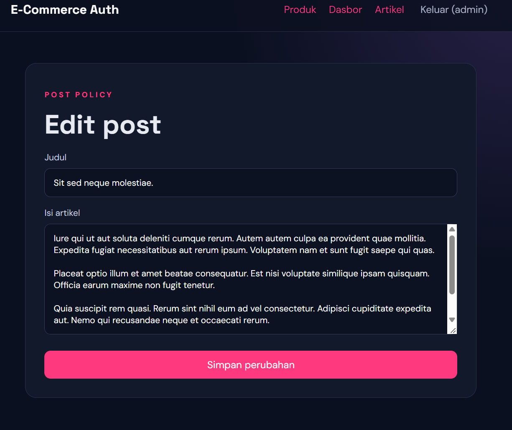

# Ecommerce Auth — Laravel

## Deskripsi Proyek

Ecommerce Auth adalah aplikasi berbasis web yang dikembangkan menggunakan Laravel. Aplikasi ini dibuat untuk memenuhi tugas praktikum Web Programming Pertemuan 11, dengan fokus pada autentikasi pengguna, pengaturan hak akses berdasarkan role, pengelolaan produk, kategori, keranjang belanja, pesanan, dan postingan.

## Fitur Aplikasi

- **Autentikasi:** Login dan pengelolaan akses pengguna.
- **Role Admin:** Memiliki hak akses administratif sesuai aturan aplikasi.
- **Role Editor:** Dapat mengelola postingan miliknya sendiri.
- **Role User:** Memiliki akses sesuai hak pengguna biasa.
- **Manajemen Produk:** Menampilkan dan mengelola data produk.
- **Manajemen Kategori:** Mengelola kategori produk.
- **Keranjang Belanja:** Menyimpan item produk yang dipilih.
- **Pesanan:** Menyimpan data pesanan, pemilik pesanan, dan item produk.
- **Policy dan Middleware:** Membatasi akses berdasarkan role dan kepemilikan postingan.
- **Query Tinker:** Memeriksa data produk, kategori, pesanan, dan scope produk.

## Teknologi yang Digunakan

- PHP
- Laravel
- MySQL
- Composer
- Node.js dan NPM
- Git dan GitHub

## Persyaratan

Pastikan perangkat sudah memiliki PHP, Composer, MySQL melalui XAMPP, serta Node.js dan NPM jika diperlukan untuk membangun aset frontend.

## Cara Instalasi

1. Clone repository:

   ```bash
   git clone https://github.com/annisa1609/TugasWeb-P11-EcommerceAuth.git
   ```

2. Masuk ke folder proyek:

   ```bash
   cd TugasWeb-P11-EcommerceAuth
   ```

3. Instal dependensi PHP:

   ```bash
   composer install
   ```

4. Salin file konfigurasi lingkungan:

   ```bash
   copy .env.example .env
   ```

5. Buat application key:

   ```bash
   php artisan key:generate
   ```

6. Buat database bernama `ecommerce_auth` melalui phpMyAdmin.

7. Sesuaikan konfigurasi database pada file `.env`:

   ```env
   DB_CONNECTION=mysql
   DB_HOST=127.0.0.1
   DB_PORT=3306
   DB_DATABASE=ecommerce_auth
   DB_USERNAME=root
   DB_PASSWORD=
   ```

8. Jalankan migrasi dan seeder:

   ```bash
   php artisan migrate --seed
   ```

9. Instal dan bangun aset frontend jika diperlukan:

   ```bash
   npm install
   npm run build
   ```

10. Jalankan aplikasi:

    ```bash
    php artisan serve
    ```

11. Buka aplikasi melalui `http://127.0.0.1:8000`.

## Akun Pengujian

| Role | Email | Password |
|---|---|---|
| Admin | admin@example.com | password |
| Editor | editor@example.com | password |
| User | user@example.com | password |

Akun di atas digunakan untuk pengujian lokal setelah seeder berhasil dijalankan.

## Dokumentasi Query Tinker

### 1. Jumlah Produk


### 2. Kategori Beserta Jumlah Produk


### 3. Pesanan, Pemilik, dan Item Produk


### 4. Produk dan Kategori


### 5. Scope Produk Tersedia


## Dokumentasi Pengujian Role dan Hak Akses

### 1. Role Admin


### 2. Role Editor — Akses Ditolak (403)


### 3. Role Editor


### 4. Role User — Akses Ditolak (403)


## Dokumentasi Post

### Admin Post



## Repository

GitHub: https://github.com/annisa1609/TugasWeb-P11-EcommerceAuth

---

**Catatan:** Dokumentasi screenshot disimpan di folder `dokumentasi`. Nama file pada README harus sesuai dengan nama file screenshot yang sebenarnya.